# send21 POS simulator 🧾

**A card terminal in your browser: type an amount, add a tip, pick 💳 card or ⚡ send21. The card side is a demo. The send21 side shows one pay link QR for the sale and prints a receipt after your server checks the payment.** Built on [send21](https://send21.io), crypto pay links and API for people and AI agents.

> ⚠️ **💳 Card is a SIMULATION ONLY: demo, no real card.** No card processing, no card data fields, no card number entry. The tap animation always ends in "approved (simulated)" and nothing is charged. Real money moves only through ⚡ send21, straight to your own wallet.

<p>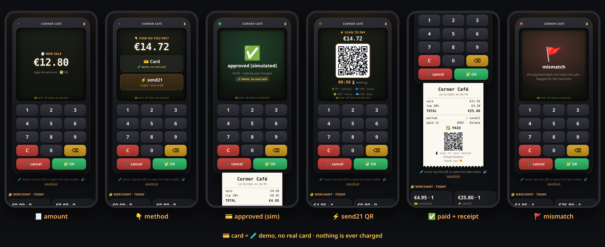</p>

<sub>Mock-mode screenshots, not real payments. 💳 card = demo, no real card.</sub>

- 🧾 A handheld terminal with a keypad, a small screen, beeps and animations. Tips of 0, 10, 15 or 20% come before payment.
- 💳 **Card (demo, no real card):** tap the fake card and get ✅ approved (simulated) plus a slip marked as a demo.
- ⚡ **send21:** one pay link QR per sale with a countdown. ✅ paid and a printed receipt with its own QR appear only after the signed webhook matches the sale.
- 🚩 Mismatch, ↩️ declined and ⌛ expired each have their own screen. Mismatches land in the merchant's review list.
- 🔐 A merchant side panel shows today's sales split into 💳 card (sim) and ⚡ send21, the tips and the review list.

| | |
| --- | --- |
| 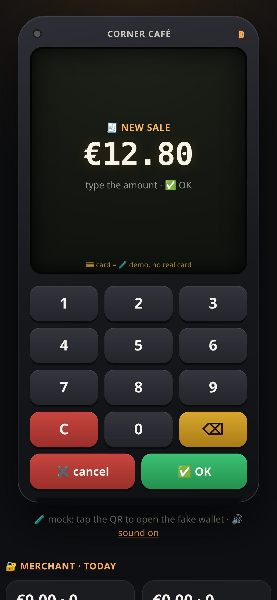 🧾 amount | 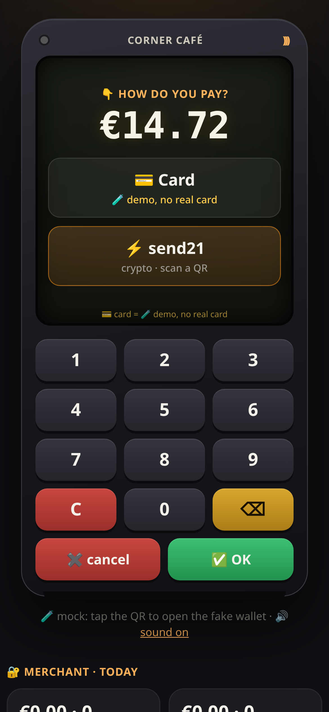 👇 method |
| 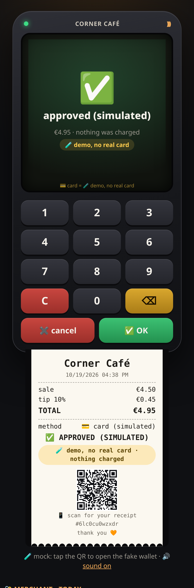 💳 approved (simulated, demo, no real card) | 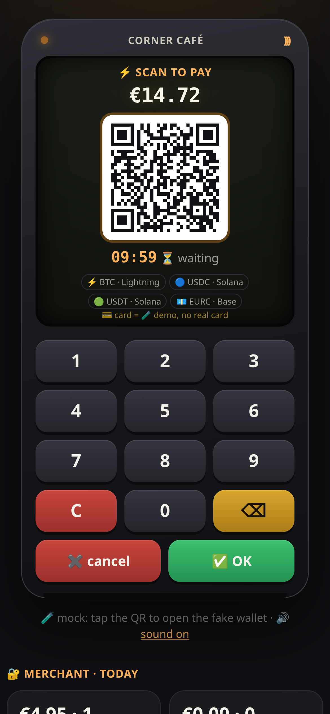 ⚡ send21 QR |
| 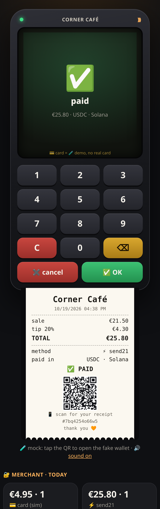 ✅ paid + receipt | 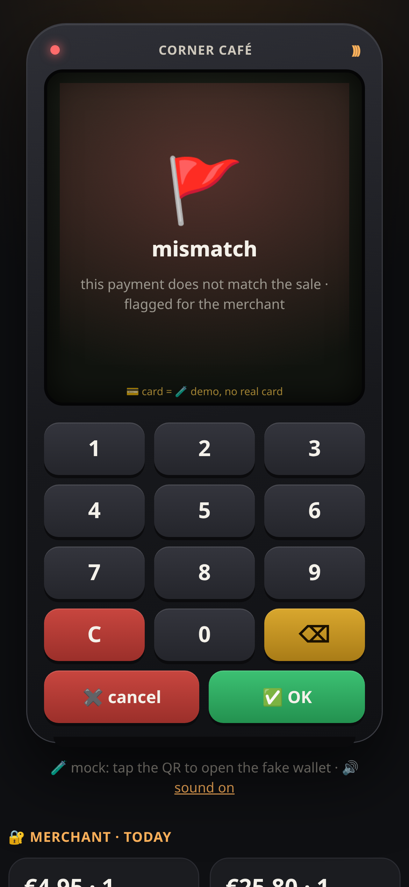 🚩 mismatch |
| 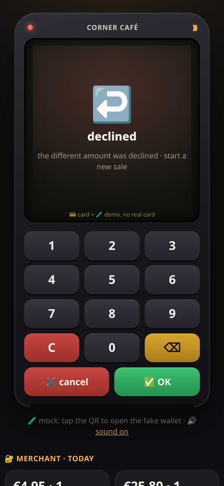 ↩️ declined | 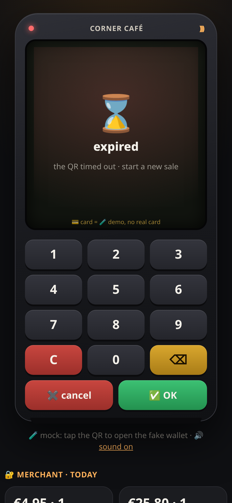 ⌛ expired |

<p>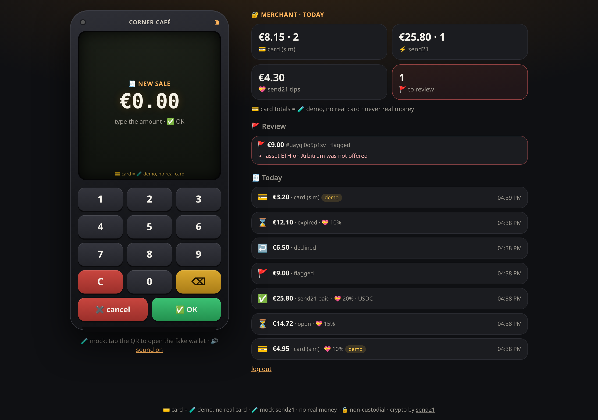</p>

## Quickstart

1. **Try it now, no keys:** run `npm install && npm run dev` and open http://localhost:3000/demo (one-click login, mock mode only). Type an amount, press ✅ OK, pick a tip, then:
   - **💳 Card (demo, no real card):** tap the fake card.
   - **⚡ send21:** click the QR to open the mock wallet. Try ✅ pay, ⚠️ pay 5% short then ↩️ decline, 🚩 wrong coin, or ⌛ expire, and watch the terminal.
2. **send21 key.** On [send21.io/api-keys](https://send21.io/api-keys), create a key with `drafts:write`. Add `webhooks:manage` for step 4.
3. **Configure.** Run `cp .env.example .env` and fill in:
   - the key and `PUBLIC_URL`
   - your own receiving addresses (`PAY_LIGHTNING`, `PAY_OPTIONS`)
   - `MERCHANT_TOKEN` (`openssl rand -base64 24`)
   - `SHOP_NAME` and `CURRENCY` (EUR, USD or GBP)
   - 🔐 **Approve your receiving addresses in send21.** New send21 accounts (created on or after 20 Oct 2026) only accept receiving addresses the owner approved, including Lightning addresses. Add them in the send21 app, or propose one from an agent (MCP `propose_receiving_address`), then sign in and approve it with a passkey or authenticator code. No API key can approve an address. Older accounts can opt in under Settings.
4. **Webhook.** Put the server behind your own HTTPS address, for example a reverse proxy with a free Let's Encrypt certificate and `TRUST_PROXY=1`. Then run `npm run webhook:register` and paste the printed `SEND21_WEBHOOK_SECRET` into `.env`.
5. **Go.** Run `npm run build && npm start`, open `https://your-site/` on the counter tablet or phone, and log in with `MERCHANT_TOKEN`.

## How it works

🧾 **The sale.** The keypad types cents and the tip is rounded to the cent. The server stores the sale. For ⚡ send21 it then creates **one** payment request:

- priced in fiat for the total including the tip, payable in your coins
- `orderId` is `pos-<saleId>`, which is also the `Idempotency-Key`, with `reuseOpenForOrder: true`

The terminal shows the returned pay link as a QR. The countdown runs to the terminal's own deadline (`TERMINAL_MINUTES`, default 10); the link on send21 lives `LINK_EXPIRY_HOURS`, at least 1. The terminal asks the server for the status every 2 s.

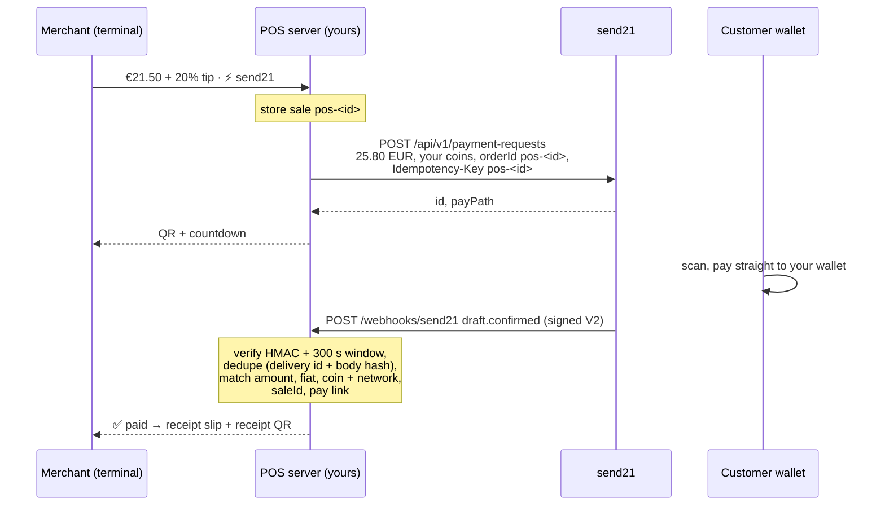

| Webhook | Terminal shows |
| --- | --- |
| `draft.seen` | 👀 on its way |
| `draft.confirmed`, matches the sale | ✅ paid + receipt |
| `draft.confirmed`, does **not** match | 🚩 mismatch, flagged for the merchant |
| `draft.amount_mismatch` | ⚠️ amount mismatch: accept or decline on send21 |
| → `draft.mismatch_accepted`, then `draft.confirmed` | 👍 then ✅ paid |
| → `draft.mismatch_rejected` | ↩️ declined |
| → `draft.mismatch_unresolved` | 🚩 unresolved, in the review list |
| `payment_request.expired`, `draft.expired`, or the terminal deadline | ⌛ expired |

A payment that arrives after ⌛ or ✖️ cancel still counts as paid. It is marked *late* in the review list so the merchant can sort it out with the customer.

**💳 Card (demo, no real card).** The server records the sale as `approved_sim` with no card data, no pay link and no call to any network. The panel keeps these totals apart and labels them "card (sim)". To accept real cards, use a licensed card provider; this repo does not.

**🧾 Receipt.** Each sale gets a 256-bit receipt key; only its hash is stored. The slip's QR opens `/r/<saleId>/<key>`, a printable receipt with the amount, tip, method and, for send21, the coin used. Card receipts say APPROVED (SIMULATED) with the demo label.

**⚡ Lightning.** send21 fetches an invoice from your Lightning address. It confirms the payment when your wallet provider supports **LUD-21**. Without LUD-21 the money still reaches you, but the terminal does not turn ✅ on its own. See [Lightning](https://send21.io/docs/lightning).

**Fees.** One small send21 fee per paid sale (0.49% on small payments, at least $0.01), never taken from the payment. See [pricing](https://send21.io/pricing).

## Troubleshooting

- **422 `address_not_approved`:** a receiving address isn't approved in your send21 account, so nothing was created. Sign in to send21, approve the address (passkey or authenticator code), then try again.

## Security notes

- **Signature V2 only.** Every delivery is checked with `X-Send21-Signature-V2`: an HMAC-SHA256 over `<t>.<delivery id>.<raw body>`, compared in constant time. Deliveries more than **300 s** old or dated in the future are refused. A bad signature gets `401` and nothing is stored.
- **Dedupe on both sides.**
  - send21 dedupes on its side: retries reuse the same `X-Send21-Delivery` id, and the `Idempotency-Key` makes one sale one link.
  - The receiver must still run its own duplicate check, and this one does. A delivery id, or the same body under a new id (sha256), is applied once.
  - The delivery record and the sale change are written in one step before the `2xx`, so a restart cannot apply a delivery twice. A failed write answers `500`, so send21 retries.
- **Exact match or 🚩.** A `draft.confirmed` must match the stored sale:
  - `orderId` `pos-<saleId>` and the pay link id
  - `status: Confirmed` and a txId
  - the fiat currency and the exact total in cents, tip included
  - a coin **and** network that the sale offered

  Anything else is flagged for the merchant and never shown as paid. Paid is final.
- **Merchant only.**
  - The terminal and panel need `MERCHANT_TOKEN`.
  - The session is an HMAC-signed cookie (`HttpOnly`, `SameSite=Strict`, `Secure` on https).
  - API POSTs are refused when `Origin` or `Sec-Fetch-Site` says cross-site.
  - `/demo` exists in mock mode only.
- **Hardened pages.**
  - Strict CSP (`'self'`, no inline script or style) and `frame-ancestors 'none'`.
  - All terminal text is set with `textContent`.
  - Tiny body limits, and sales and logins are rate-limited per IP.
  - The API key is never logged and cannot move funds.
- **No card data, ever.** There is no card form, field or storage anywhere in this repo. 💳 is a demo, no real card.
- **Data.** Everything lives in one JSON file (`DATA_FILE`, mode 600), written atomically. For several processes, use SQLite or Postgres.

## Develop

```bash
npm run check   # typecheck + lint + tests: signature, dedupe, restart, exact match, tips, card sim, receipts, panel
```

API reference: [send21.io/docs](https://send21.io/docs) · [quickstart](https://send21.io/docs/quickstart) · [webhooks](https://send21.io/docs/webhooks) · [llms-full.txt](https://send21.io/llms-full.txt). More examples: [send21-examples](https://github.com/send21io/send21-examples).

Questions: [info@send21.io](mailto:info@send21.io). License: [MIT](LICENSE).
